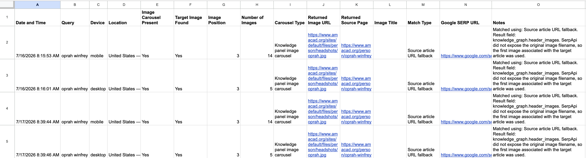

# SERP Image Monitoring Automation

### Project Overview

An automated search engine results page (SERP) monitoring tool built with Google Apps Script and SerpApi to track image visibility and ranking across mobile and desktop Google search results.

This project originated from a recurring workflow challenge I identified while working as a Technical SEO Analyst.

### The Problem

Monitoring image rankings manually created three challenges:

- **Time:** Repetitive searches took time away from analysis and strategic work.
- **Consistency:** Search results could vary depending on the searcher's location, making comparisons difficult.
- **Missing data:** If a daily ranking check was forgotten, that day's observation was lost, creating gaps in historical reporting.

I wanted to create a more reliable, scalable way to collect search visibility data without depending on someone remembering to perform manual checks.

### The Solution

I developed an automation using Google Apps Script and SerpApi that:

- Retrieves Google search results for a specified query.
- Checks mobile and desktop search results.
- Identifies image carousels and searches for a target image.
- Uses image URLs, filenames, and source-page information to evaluate matches.
- Records image position when a match can be confirmed.
- Logs timestamped observations in Google Sheets.
- Supports scheduled daily execution.

### Technical Approach

**Technologies:** Google Apps Script, JavaScript, SerpApi, Google Sheets

The script integrates with SerpApi to retrieve search data, processes image results to identify the target image, and appends observations to a spreadsheet.

The matching logic distinguishes between confirmed image matches and less certain source-page matches to avoid reporting unverified rankings as confirmed.

### Example Output

The demonstration records search query, device, location, image carousel presence, target image status, ranking position, image count, match type, and diagnostic notes.

### Outcome

The automation replaced repetitive manual monitoring with a repeatable process for collecting search visibility observations. It reduced manual work, improved consistency, and reduced the risk of missing historical ranking data because a daily check was forgotten.

### Public Demonstration Disclosure

This repository contains an independently recreated version of an internal automation project, adapted for public demonstration using a non-client search query.

It is not the original production implementation and is not intended to disclose employer-owned source code, confidential client information, or proprietary data.

### Source Code

The demonstration implementation is available in [Code.gs](Code.gs).

To run it, users must provide their own SerpApi credentials through Google Apps Script's Script Properties.
